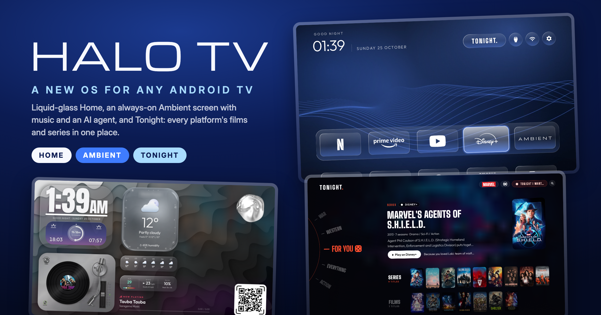
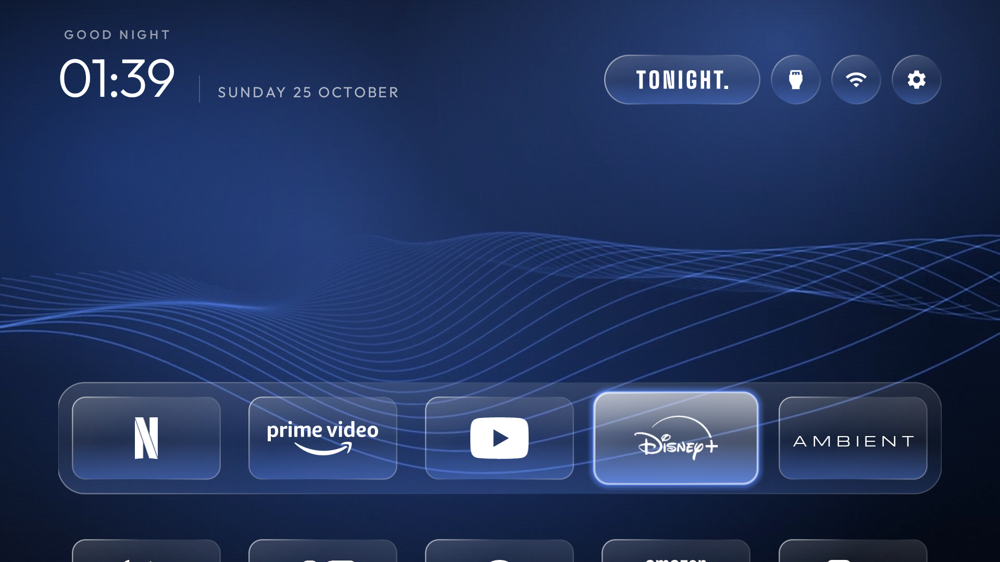
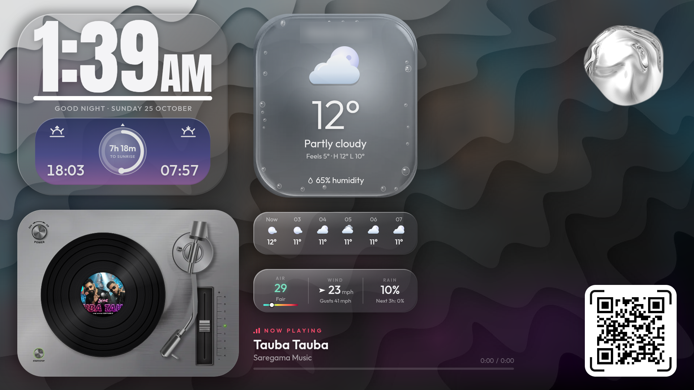
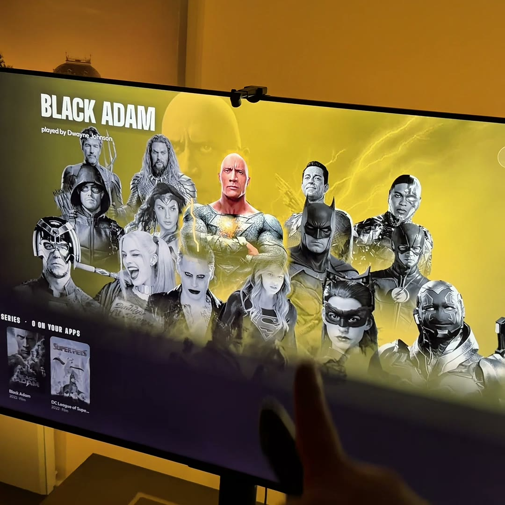
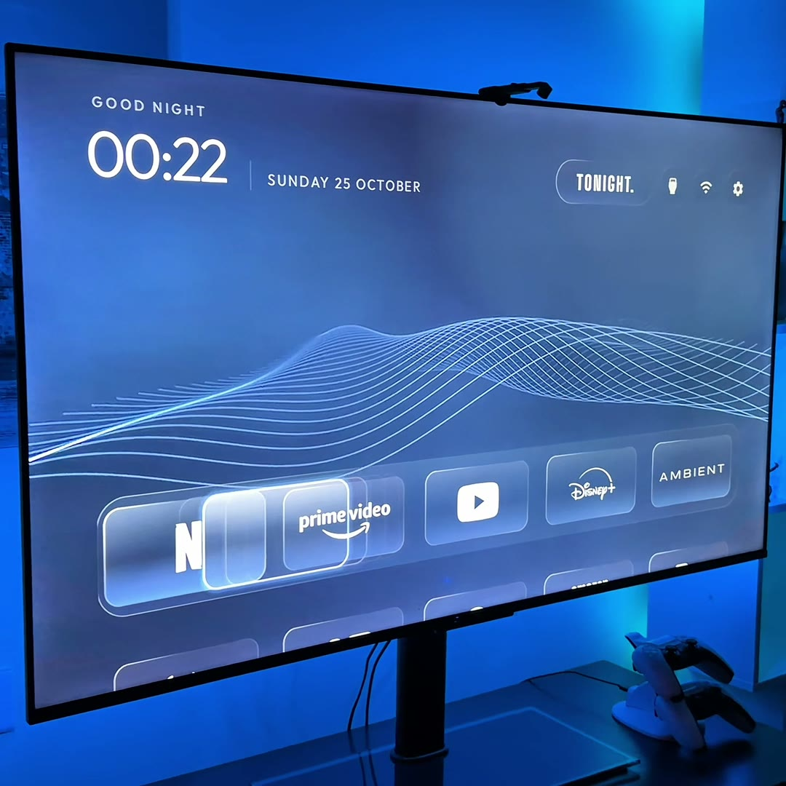
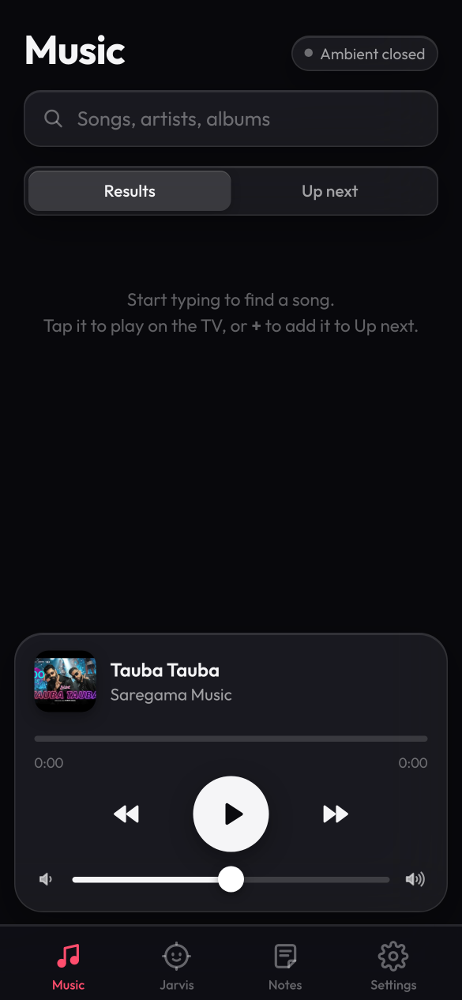
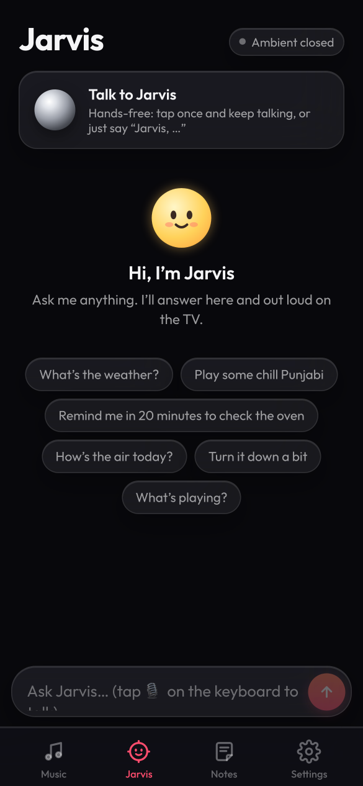
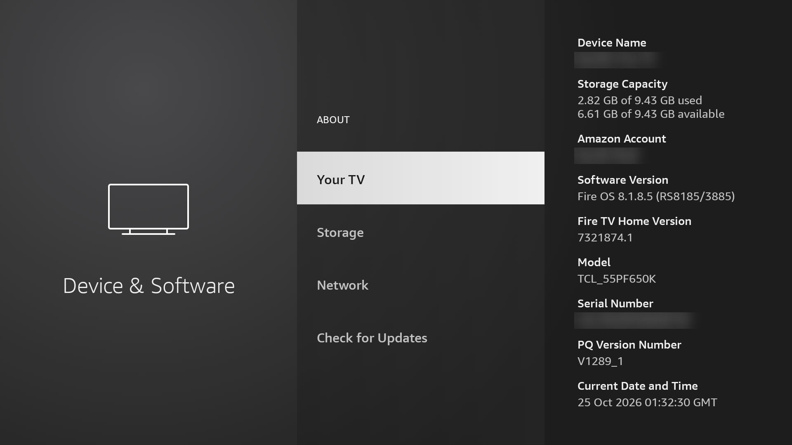

<p align="center"></p>

# Halo TV

**A new OS for any Android TV, Google TV or Fire TV.** Halo TV replaces your TV's ad-filled home screen with three things:

| | |
|---|---|
| **Home** | A liquid-glass home screen in one colour (Midnight), a slow *Waves* motion backdrop behind the glass, and clean white logos instead of app banners. No ads, no sponsored rows. |
| **Ambient** | An always-on screen with a clock, sunrise/sunset, weather, air quality, a turntable music player and **Jarvis**, an AI agent that talks back. Everything is controllable from a web app on your phone: scan the QR code on the screen. |
| **Tonight** | One place to find films and series across Netflix, Prime Video, Disney+ and more. A genre wheel, AI picks that remember your taste, and a **Marvel and DC Hall of Heroes** listing every film and series a hero has been in. |

It installs over Wi-Fi from your computer in one command, and it's built to be installed **by an AI coding agent** (Claude Code, Codex or ChatGPT). Give your agent this repo and it does the setup with you.

---

## Contents

- [Screenshots](#screenshots)
- [Install with an AI agent (easiest)](#install-with-an-ai-agent-easiest)
- [Install by hand](#install-by-hand)
  - [1. What you need](#1-what-you-need)
  - [2. Turn on ADB debugging on the TV](#2-turn-on-adb-debugging-on-the-tv)
  - [3. Get your keys](#3-get-your-keys)
  - [4. Run the installer](#4-run-the-installer)
  - [5. First run](#5-first-run)
- [Using Halo TV](#using-halo-tv)
- [Jarvis relay and Alexa (optional)](#jarvis-relay-and-alexa-optional)
- [Customise](#customise)
- [Uninstall](#uninstall)
- [Troubleshooting](#troubleshooting)
- [Keys and privacy](#keys-and-privacy)
- [Project layout](#project-layout)
- [License](#license)

---

## Screenshots

All captured on a real TV running this code.

**Home.** Liquid glass, Midnight colour, Waves motion, white logos. The TONIGHT. button opens Tonight.



**Ambient.** Clock, sunrise, weather, air, the turntable player and Jarvis (the chrome orb). Scan the QR code to control it from a phone.



**Tonight.** Genre wheel, AI picks "because you loved…", films and series from every service you have.


**Hall of Heroes, and the whole thing in real life.**

| Marvel and DC | Hall of Heroes | Home |
|---|---|---|
|  |  |  |

**Phone web app.** Music, Jarvis, notes and settings, opened by scanning the QR code on Ambient.

| Music | Jarvis |
|---|---|
|  |  |

---

## Install with an AI agent (easiest)

Open **Claude Code**, **Codex**, or **ChatGPT** with a terminal/agent mode, and paste:

```text
Clone https://github.com/kartik-modi/halo-tv and install Halo TV on my TV.
Follow AGENTS.md in the repo step by step, and ask me for anything you need.
```

The agent reads [AGENTS.md](AGENTS.md), checks your computer's tools, asks for your TV's IP address and your keys, builds both apps and installs them. You only need to do two things on the TV yourself: turn on ADB debugging ([step 2](#2-turn-on-adb-debugging-on-the-tv)) and press **OK** on the "Allow USB debugging?" prompt.

---

## Install by hand

### 1. What you need

| | |
|---|---|
| **A TV** | Any Android TV or Google TV (Android 8.0+), or a Fire TV / Fire TV Stick / Fire TV Edition television |
| **A computer** | macOS or Linux (Windows: use WSL), on the same Wi-Fi as the TV |
| **JDK 17** | macOS: `brew install openjdk@17` · Ubuntu: `sudo apt install openjdk-17-jdk` |
| **Android SDK** | macOS: `brew install --cask android-commandlinetools` · or install Android Studio. Then accept the licences once: `yes \| sdkmanager --licenses` |
| **Python 3** | Already on macOS and most Linux distributions. Used for the built-in ADB client (no `adb` install needed). |
| **Node.js 18+** | Only for the optional [Jarvis relay](#jarvis-relay-and-alexa-optional) |

### 2. Turn on ADB debugging on the TV

ADB debugging lets your computer install apps on the TV over Wi-Fi. You do this once.

<details open>
<summary><b>Google TV / Android TV</b> (Sony, TCL, Hisense, Philips, Xiaomi, Chromecast with Google TV, NVIDIA Shield…)</summary>

1. **Settings → System → About.**
2. Scroll to **Android TV OS build** and click it **7 times**, until it says *You are now a developer*.
3. Go back to **Settings → System → Developer options** and turn on **USB debugging**.
   On some TVs there is also **Network debugging** or **ADB over network**: turn that on too.
4. Find the TV's IP address in **Settings → Network & Internet → (your Wi-Fi)**.

</details>

<details open>
<summary><b>Fire TV</b> (Fire TV Stick, Fire TV Cube, Fire TV Edition / Omni televisions)</summary>

1. **Settings → My Fire TV** (on newer models **Settings → Device & Software**) **→ About**.
2. Click **Your TV** (or your device's name) **7 times**, until it says *You are now a developer*.

   

3. Go back one screen and open **Developer Options**. Turn on **ADB debugging**.
4. Find the TV's IP address in **Settings → Network**: highlight your Wi-Fi network and press **Play/Pause**.

</details>

### 3. Get your keys

Keys are typed into the installer (hidden as you type) and saved only on your computer in `tonight/secrets.properties`, which git ignores. **Nothing secret is ever committed.**

| Key | Needed for | Where to get it | Cost |
|---|---|---|---|
| **TMDB API Read Access Token** | Tonight (required for Tonight) | [themoviedb.org/settings/api](https://www.themoviedb.org/settings/api): create a free account, request an API key, then copy the long *API Read Access Token* | Free |
| **Anthropic API key** | Tonight's AI picks and taste memory (optional) | [console.anthropic.com/settings/keys](https://console.anthropic.com/settings/keys) | Pay as you go, a few cents a month |
| **OpenAI API key** | Jarvis's natural voice and smarter answers on Ambient (optional) | [platform.openai.com/api-keys](https://platform.openai.com/api-keys). Entered later on the phone web app, not in the installer | Pay as you go |

### 4. Run the installer

```bash
git clone https://github.com/kartik-modi/halo-tv.git
cd halo-tv
./install.sh
```

It walks through seven steps:

1. **Checks your tools** (JDK 17, Android SDK, Python) and tells you exactly what to install if something is missing.
2. **Connects to the TV.** Enter its IP address.
3. **Asks for your keys** (step 3 above) and your country (for Tonight's services), and writes them to the git-ignored `tonight/secrets.properties`.
4. **Builds** Home and Tonight.
5. **Installs Home + Ambient** and makes it your home screen:
   - **Google TV / Android TV:** Halo TV becomes the real Home and the stock launcher is disabled (not deleted). If anything goes wrong it is put back automatically.
   - **Fire TV:** Fire OS doesn't let another app own Home, so the Amazon launcher stays and Halo TV's Home-button service sends the Home button to Halo TV.
6. **Installs the Waves backdrop** behind the glass.
7. **Installs Tonight.**

Useful options:

```bash
./install.sh --tv 192.168.1.50          # skip the IP prompt
./install.sh --home-only                # Home + Ambient only
./install.sh --tonight-only             # Tonight only
./install.sh --keep-stock               # never disable the stock launcher (use the Home-button redirect)
./install.sh --input-key-service        # also open Halo TV's input switcher from the remote's Input button
TV_HOST=192.168.1.50 TMDB_TOKEN=... REGION=US ANTHROPIC_KEY=... ./install.sh --yes   # no prompts
```

Re-running it is safe: it reinstalls over the existing apps and keeps your settings.

### 5. First run

- The first time the installer connects, the TV shows **"Allow USB debugging?"**. Tick **Always allow from this computer** and choose **OK**. (If you miss it, run `./install.sh` again.)
- Press **Home** on the remote: Halo TV opens.
- Tonight builds its search index in the background over the first hour; browsing works straight away.

---

## Using Halo TV

| | |
|---|---|
| **Home** | Arrow keys move between apps; the first row is the dock. **TONIGHT.** in the top bar opens Tonight. **Inputs**, **Wi-Fi** and **Settings** sit next to it. Hold **OK** on Settings for launcher settings. |
| **Ambient** | The **AMBIENT** tile on the dock. Leave it on as a screensaver-style display. |
| **Phone web app** | Scan the QR code on Ambient, or open `http://<TV-IP>:8765` on a phone on the same Wi-Fi. **Music**: search and play on the TV, queue songs. **Jarvis**: type or talk. **Settings**: weather location, OpenAI key for Jarvis's voice. Add it to your home screen for an app icon. |
| **Jarvis** | Ask for the weather, music, timers ("remind me in 20 minutes to check the oven"), the volume, or anything else. With an OpenAI key it speaks in a natural voice; without one it uses the TV's own voice. |
| **Tonight** | Spin the genre wheel, open **For You** for AI picks, use search (top right), or pick **MARVEL** / **DC** for the Hall of Heroes. **Play on…** opens the title in the right app. |

---

## Jarvis relay and Alexa (optional)

Jarvis already works from the phone web app on your Wi-Fi. The relay is a tiny free [Cloudflare Worker](https://workers.cloudflare.com/) that also lets **Alexa** ("Alexa, ask Jarvis to…") and your phone **away from home** reach the TV.

```bash
jarvis/setup-relay.sh --tv 192.168.1.50
```

It logs in to Cloudflare (a browser window opens), deploys `jarvis/relay`, generates two random keys (`TV_KEY` for the TV, `PHONE_KEY` for your phone), stores them as Worker secrets, and pairs the TV. The keys never touch the repo. It fits easily in Cloudflare's free plan.

### Alexa skills

Optional, and needs an [Amazon developer account](https://developer.amazon.com/alexa/console/ask) (free).

1. Run `jarvis/setup-relay.sh` first. It writes ready-to-use manifests pointing at your relay to `.halo/alexa/jarvis-skill.json` and `.halo/alexa/tonight-skill.json` (git-ignored).
2. Install the Alexa CLI and log in: `npm install -g ask-cli && ask configure`.
3. Create each skill and upload its model:
   ```bash
   ask smapi create-skill-for-vendor --manifest "file:.halo/alexa/jarvis-skill.json"     # prints the skill id
   ask smapi set-interaction-model --skill-id <skill-id> --stage development --locale en-GB \
     --interaction-model "file:jarvis/alexa/jarvis/en-GB.json"
   ```
   Repeat with `tonight-skill.json` and `jarvis/alexa/tonight/en-GB.json`.
4. Tell the relay which skills to trust:
   ```bash
   cd jarvis/relay
   npx wrangler@4 secret put SKILL_ID           # the Jarvis skill id
   npx wrangler@4 secret put TONIGHT_SKILL_ID   # the Tonight skill id
   ```
5. In the Alexa app, enable both skills under **Your Skills → Dev**. Then: *"Alexa, ask Jarvis to play some chill music"*, or *"Alexa, ask Tonight for something like Loki"*.

---

## Customise

Home's look and dock live in [`home/app/src/main/res/values/config.xml`](home/app/src/main/res/values/config.xml). Edit it, then run `./install.sh --home-only`.

| Setting | What it does |
|---|---|
| `dock_apps` | Apps on the dock, in order. List both the Google TV and Fire TV package of an app; the missing one is skipped. |
| `hidden_apps` | Apps never shown on Home. |
| `glass_home` | The liquid-glass look (on by default). |
| `glass_accent` / `glass_background` | The one colour: Midnight is `#FF5B8CFF` on `#FF040914`. Try `#FFFF5B8C` for a rose theme. |
| `glass_backdrop` | `video` (Waves behind plain glass, light), `lens` (Waves bent through the glass, heavier), or `still` (gradient only). |
| `columns` | Tiles per row (5 by default). |
| `live_tv_package` | Your TV's Live TV app for the Inputs menu (find it with `tools/tv.py "pm list packages"`). |

Replace `assets/waves.mp4` with any looping 960×540 video for a different backdrop.

Tonight's country is `region=` in `tonight/secrets.properties`. Its rows and genre rules are in `tonight/app/src/main/java/com/kartikmodi/halo/tonight/`.

---

## Uninstall

```bash
./uninstall.sh --tv 192.168.1.50
```

Re-enables the stock launcher, removes Halo TV's Home-button service, and uninstalls both apps. Your TV is exactly as it was.

---

## Troubleshooting

| Problem | Fix |
|---|---|
| `could not connect to …:5555` | ADB debugging is off, the IP is wrong, or the TV is on a different network. On Google TV also check **Network debugging**. Restart the TV and try again. |
| The TV never showed "Allow USB debugging?" | It may be behind the current app: press **Home**. Or revoke old authorisations in Developer options and run the installer again. |
| Home button still opens the old home | Fire TV / `--keep-stock`: the Home-button service is off. Turn on **Halo TV Home button** in **Settings → Accessibility** and run the installer again. Google TV: run `./install.sh`; it reports where Home resolves. |
| `Home currently resolves to …setupwraith` (Google TV) | Google's setup wizard is claiming Home. Use `./install.sh --keep-stock`. |
| No Waves behind the glass | Run `./install.sh --home-only` again, or set `glass_backdrop` to `still` on low-end TVs. |
| Tonight is empty | The TMDB token is missing or wrong. Fix `tonight/secrets.properties` and run `./install.sh --tonight-only`. |
| No AI picks in Tonight | Add an Anthropic key to `tonight/secrets.properties` and run `./install.sh --tonight-only`. |
| The phone web app won't open | The phone must be on the same Wi-Fi as the TV. Open `http://<TV-IP>:8765`. |
| Build fails with a licence error | `yes \| sdkmanager --licenses`, then run again. |

---

## Keys and privacy

- **No key is in this repository.** The installer writes your keys to `tonight/secrets.properties`, which is git-ignored (see [`tonight/secrets.properties.example`](tonight/secrets.properties.example)).
- Your TMDB and Anthropic keys are built into **your** copy of Tonight. Don't share the APK you build.
- The OpenAI key for Jarvis is entered on the phone web app and stored **only on the TV**; the TV never sends it back out.
- The relay keys are generated on your computer and stored as Cloudflare Worker secrets and on the TV.
- The ADB key that lets your computer talk to the TV is created in `tools/adbkey/` (git-ignored).
- Ambient asks a public IP-location service for your town, for the weather, unless you set a location on the phone web app.

---

## Project layout

```
home/                  Home + Ambient (Android app com.kartikmodi.halo.home)
  app/src/main/assets/ambient/   Ambient screen (tv.html) and the phone web app (phone.html)
  app/src/main/res/values/config.xml   dock, hidden apps, colours, look
tonight/               Tonight (Android app com.kartikmodi.halo.tonight)
  secrets.properties.example     the keys Tonight reads at build time
jarvis/
  relay/               Cloudflare Worker that connects Alexa and your phone to the TV
  alexa/               Alexa skill manifests and interaction models (Jarvis, Tonight)
  setup-relay.sh       deploys the relay and pairs the TV
tools/                 tv.py: a small ADB-over-Wi-Fi client (no adb install needed); b64push.py
assets/waves.mp4       the Waves backdrop video
install.sh             builds and installs everything
uninstall.sh           puts the TV back the way it was
AGENTS.md              step-by-step instructions for AI agents (Claude Code, Codex, ChatGPT)
```

---

## License

MIT. See [LICENSE](LICENSE). Bundled fonts are under the SIL Open Font License. App names, logos and film/series artwork belong to their owners; this project is not affiliated with any streaming service, Amazon, Google, Marvel or DC.
